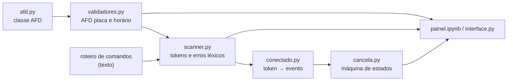
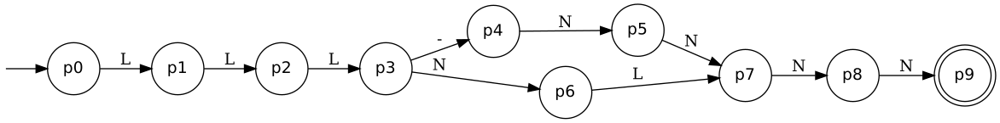
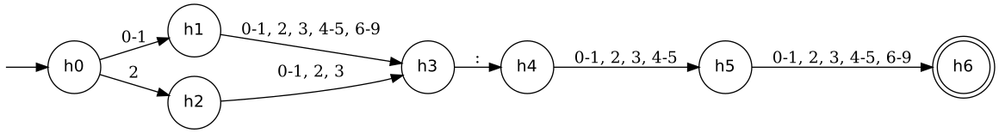
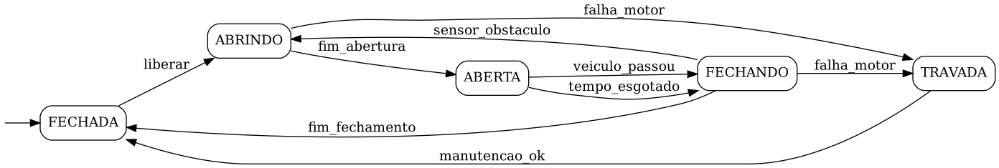
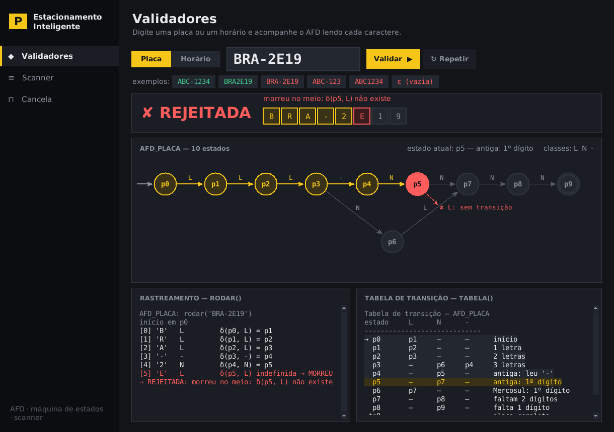
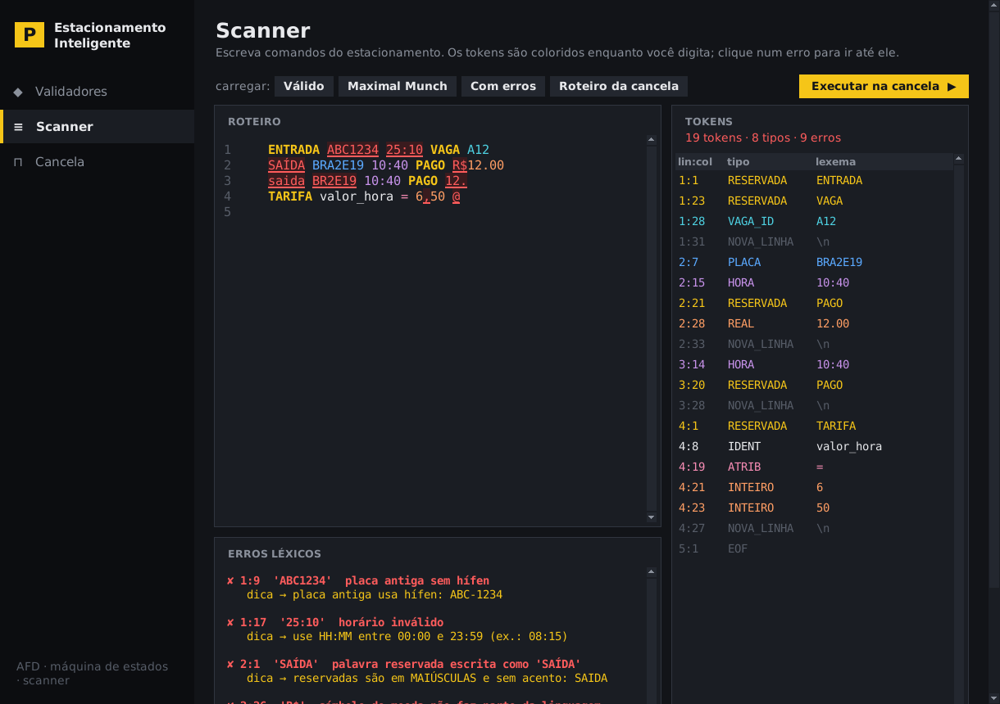
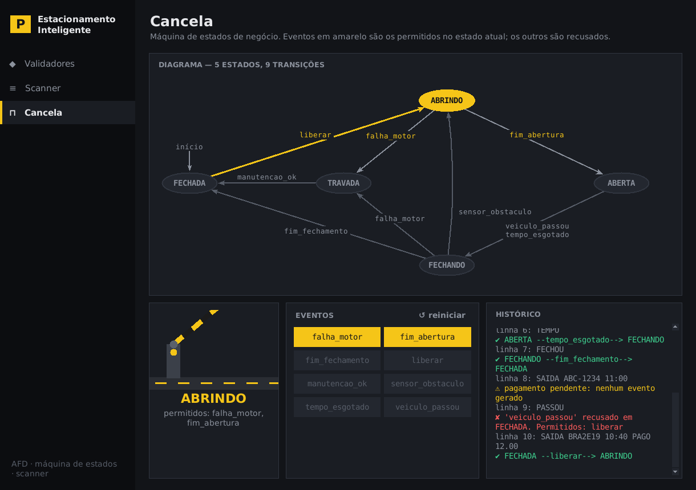
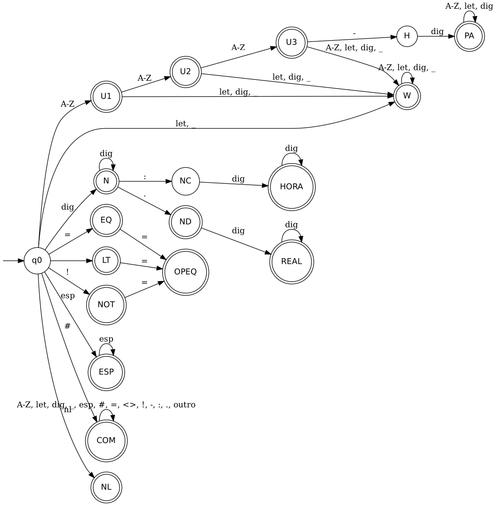

# 🅿️ Estacionamento Inteligente — Validador & Scanner

**Integrantes:**
<!-- TROCAR pelos nomes reais do grupo (4 a 6 integrantes) antes de entregar -->
- Nome Completo 1
- Nome Completo 2
- Nome Completo 3
- Nome Completo 4

**Tema:** Estacionamento inteligente — validação de placas e horários, controle da cancela e leitura de comandos de entrada/saída.

 -brightgreen) 

## Resumo

Projeto da **Prática 3 — Validador & Scanner do domínio**. Para o domínio *estacionamento*, construímos os três tipos de autômato vistos em aula:

1. **Validadores** (AFD) para o formato da **placa** (antiga e Mercosul) e do **horário** `HH:MM`, cada um conferido contra uma RegEx equivalente.
2. **Máquina de estados de negócio** para a **cancela** (5 estados, 9 transições), que recusa eventos inválidos e mostra os permitidos.
3. **Mini-scanner** para uma linguagem de comandos (`ENTRADA`, `SAIDA`, `PAGO`…), com Maximal Munch e erros léxicos com linha, coluna e dica, implementado **por tabela** (AFD combinado com `delta`).

Os três se conectam: um roteiro de comandos em texto passa pelo scanner e os tokens viram eventos da cancela. Tudo pode ser testado em um **painel interativo** (`painel.ipynb`, ipywidgets) ou na janela desktop (tkinter).

### Mapa dos requisitos

| Requisito | Onde ver neste README | Código |
|---|---|---|
| **R1** Dois AFDs com desenho e `tabela()` | [AFD 1](#afd-1--placa-antiga--mercosul) e [AFD 2](#afd-2--horário-hhmm) | `validadores.py`, `afd.py` |
| **R2** Rastreamento `rodar()` explicado | seção `rodar()` de cada AFD | `afd.py` |
| **R3** Bateria AFD × RegEx (0 divergências) | seção *RegEx equivalente e bateria* de cada AFD | `validadores.py` |
| **R4** Máquina de estados de negócio | [Máquina de estados — Cancela](#máquina-de-estados--cancela) | `cancela.py` |
| **R5** Mini-scanner | [Mini-scanner de comandos](#mini-scanner-de-comandos) | `scanner.py` |
| **R6** Interface | [Interface](#interface) | `painel.ipynb`, `interface.py` |
| **R7** README | este arquivo | `README.md` |
| **Bônus** | [Bônus](#bônus) | `afd.py`, `conectado.py` |

### Como as partes se conectam



---

## Sumário
1. [Resumo e mapa dos requisitos](#resumo)
2. [Como rodar](#como-rodar)
3. [AFD 1 — Placa (antiga + Mercosul)](#afd-1--placa-antiga--mercosul)
4. [AFD 2 — Horário HH:MM](#afd-2--horário-hhmm)
5. [Máquina de estados — Cancela](#máquina-de-estados--cancela)
6. [Mini-scanner de comandos](#mini-scanner-de-comandos)
7. [Interface](#interface)
8. [Bônus](#bônus)
9. [Checklist](#checklist)
10. [Estrutura](#estrutura)
11. [Problemas comuns](#problemas-comuns)
12. [Referências](#referências)

---

## Como rodar

**Início rápido**
```bash
cd estacionamento-py          # entre na pasta onde está o main.py
python main.py --sem-gui      # roda tudo e mostra o checklist final
jupyter notebook painel.ipynb # ou abra o painel interativo (precisa: pip install ipywidgets jupyter)
```

Requisito: **Python 3.8+**. Não precisa instalar nada para o projeto principal (usa só a biblioteca padrão; a interface usa `tkinter`, que já vem com o Python).

**No VS Code**
1. *Arquivo → Abrir pasta…* e escolha a pasta do projeto.
2. Abra `main.py` e clique em ▶ *Run Python File* (ou no terminal integrado):

```bash
python main.py            # roda todas as demonstrações + checklist e pergunta se abre a interface
python main.py --gui      # abre direto a interface gráfica
python main.py --sem-gui  # só as demonstrações
```

**Notebook:** `painel.ipynb` traz o painel ipywidgets (veja a seção [Interface](#interface)).

Cada parte também roda sozinha: `python validadores.py`, `python cancela.py`, `python scanner.py`, `python conectado.py`, `python interface.py`.

**Opcional (bônus de desenho):** para regenerar as imagens de `img/` a partir do `delta`:
```bash
pip install graphviz      # + Graphviz do sistema: https://graphviz.org/download/
```
Sem isso o programa só avisa que pulou o desenho; as imagens prontas já estão em `img/`.

A última seção da saída (`CHECKLIST`) confere automaticamente todos os requisitos numéricos.

**Testes automáticos:** `python testes.py` roda os testes (um grupo por requisito, incluindo o scanner por tabela e o painel) e deve terminar com `OK`.

---

## AFD 1 — Placa (antiga + Mercosul)

Aceita, **no mesmo AFD**, a placa antiga `ABC-1234` e a Mercosul `BRA2E19`.

Classes de símbolo: `L` = letra maiúscula A–Z · `N` = dígito 0–9 · `-` = hífen. Qualquer outro caractere está fora de Σ e mata a palavra.

### Desenho

```
         L      L      L      -      N      N      N      N
 →(p0)──▶(p1)──▶(p2)──▶(p3)──▶(p4)──▶(p5)──▶(p7)──▶(p8)──▶((p9))
                         │                    ▲
                         │ N                  │ L
                         └──────▶(p6)─────────┘
```



Os dois formatos se separam em `p3` e voltam a se juntar em `p7` ("faltam 2 dígitos"), porque os dois terminam igual.

### `tabela()`

```
Tabela de transição — AFD_PLACA
estado     L      N      -
-----------------------------
→ p0       p1     —      —      início
  p1       p2     —      —      1 letra
  p2       p3     —      —      2 letras
  p3       —      p6     p4     3 letras
  p4       —      p5     —      antiga: leu '-'
  p5       —      p7     —      antiga: 1º dígito
  p6       p7     —      —      Mercosul: 1º dígito
  p7       —      p8     —      faltam 2 dígitos
  p8       —      p9     —      falta 1 dígito
 *p9       —      —      —      placa completa
(→ inicial, * final, — sem transição = morre)
```

### `rodar()` — passo a passo

```
AFD_PLACA: rodar('BRA2E19')
  início em p0
  [0] 'B'   classe L          δ(p0, L) = p1
  [1] 'R'   classe L          δ(p1, L) = p2
  [2] 'A'   classe L          δ(p2, L) = p3
  [3] '2'   classe N          δ(p3, N) = p6
  [4] 'E'   classe L          δ(p6, L) = p7
  [5] '1'   classe N          δ(p7, N) = p8
  [6] '9'   classe N          δ(p8, N) = p9
  ⇒ ACEITA: terminou em p9 ∈ F

AFD_PLACA: rodar('BRA-2E19')
  ...
  [3] '-'   classe -          δ(p3, -) = p4
  [4] '2'   classe N          δ(p4, N) = p5
  [5] 'E'   classe L          δ(p5, L) indefinida → MORREU NO MEIO
  ⇒ REJEITADA: morreu no meio (não existe transição)

AFD_PLACA: rodar('ABC-123')
  ...
  [6] '3'   classe N          δ(p7, N) = p8
  ⇒ REJEITADA: terminou em p8 ∉ F (falta 1 dígito)
```

**Por que foram rejeitadas?**
- `BRA-2E19` **morreu no meio**: o hífen escolheu o caminho da placa antiga (`p4`), que só aceita dígitos; a letra `E` em `p5` não tem transição.
- `ABC-123` **terminou fora de F**: todos os caracteres foram lidos, mas a palavra acabou em `p8` (falta 1 dígito), que não é final.

### RegEx equivalente e bateria

```
^[A-Z]{3}(-[0-9]{2}|[0-9][A-Z])[0-9]{2}$
```

| palavra | esperado | AFD | RegEx |
|---|---|---|---|
| `ABC-1234` | aceita | aceita | aceita |
| `BRA2E19` | aceita | aceita | aceita |
| `XYZ-0000` | aceita | aceita | aceita |
| `RIO2A18` | aceita | aceita | aceita |
| `AAA0A00` | aceita | aceita | aceita |
| `QWE-9876` | aceita | aceita | aceita |
| ε (vazia) | rejeita | rejeita | rejeita |
| `ABC1234` | rejeita | rejeita | rejeita |
| `BRA-2E19` | rejeita | rejeita | rejeita |
| `abc-1234` | rejeita | rejeita | rejeita |
| `ABC-123` | rejeita | rejeita | rejeita |
| `BRA2E1` | rejeita | rejeita | rejeita |
| `AB-1234` | rejeita | rejeita | rejeita |
| `BRA2E199` | rejeita | rejeita | rejeita |
| `ABC 1234` | rejeita | rejeita | rejeita |
| `ABC-12345` | rejeita | rejeita | rejeita |

**6 aceitas, 10 rejeitadas, 0 divergências.**

---

## AFD 2 — Horário HH:MM

Horas de `00` a `23`, minutos de `00` a `59`. Aqui um "dígito" genérico não basta, por isso usamos **classes finas**:

| classe | dígitos | papel |
|---|---|---|
| `0-1` | 0, 1 | 1º dígito da hora que libera qualquer 2º dígito |
| `2` | 2 | 1º dígito da hora que só libera 0–3 |
| `3` | 3 | permitido depois do `2`, proibido como 1º dígito |
| `4-5` | 4, 5 | ainda valem como dezena do minuto |
| `6-9` | 6–9 | só valem como unidade |
| `:` | : | separador |

### Desenho

```
        0-1         0-9          :        0-5         0-9
 →(h0)──────▶(h1)─────────▶(h3)─────▶(h4)──────▶(h5)──────▶((h6))
   │                         ▲
   │ 2                       │ 0-3
   └─────────▶(h2)───────────┘
```



### `tabela()`

```
Tabela de transição — AFD_HORARIO
estado    0-1     2      3     4-5    6-9     :
--------------------------------------------------
→ h0       h1     h2     —      —      —      —      início
  h1       h3     h3     h3     h3     h3     —      hora 0X/1X
  h2       h3     h3     h3     —      —      —      hora 2X
  h3       —      —      —      —      —      h4     hora completa
  h4       h5     h5     h5     h5     —      —      leu ':'
  h5       h6     h6     h6     h6     h6     —      dezena do minuto
 *h6       —      —      —      —      —      —      horário completo
(→ inicial, * final, — sem transição = morre)
```

### `rodar()` — passo a passo

```
AFD_HORARIO: rodar('23:59')
  início em h0
  [0] '2'   classe 2          δ(h0, 2) = h2
  [1] '3'   classe 3          δ(h2, 3) = h3
  [2] ':'   classe :          δ(h3, :) = h4
  [3] '5'   classe 4-5        δ(h4, 4-5) = h5
  [4] '9'   classe 6-9        δ(h5, 6-9) = h6
  ⇒ ACEITA: terminou em h6 ∈ F

AFD_HORARIO: rodar('24:00')
  [0] '2'   classe 2          δ(h0, 2) = h2
  [1] '4'   classe 4-5        δ(h2, 4-5) indefinida → MORREU NO MEIO
  ⇒ REJEITADA: morreu no meio (não existe transição)

AFD_HORARIO: rodar('12:5')
  ...
  [3] '5'   classe 4-5        δ(h4, 4-5) = h5
  ⇒ REJEITADA: terminou em h5 ∉ F (dezena do minuto)
```

**Por que foram rejeitadas?**
- `24:00` **morreu no meio**: depois de um `2` na hora, só as classes `0-1`, `2`, `3` têm transição; `4` não existe como hora.
- `12:5` **terminou fora de F**: parou em `h5`, faltou a unidade do minuto.

### RegEx equivalente e bateria

```
^([01][0-9]|2[0-3]):[0-5][0-9]$
```

| palavra | esperado | AFD | RegEx |
|---|---|---|---|
| `00:00` | aceita | aceita | aceita |
| `08:15` | aceita | aceita | aceita |
| `23:59` | aceita | aceita | aceita |
| `19:45` | aceita | aceita | aceita |
| `12:30` | aceita | aceita | aceita |
| `09:05` | aceita | aceita | aceita |
| `20:00` | aceita | aceita | aceita |
| ε (vazia) | rejeita | rejeita | rejeita |
| `24:00` | rejeita | rejeita | rejeita |
| `8:15` | rejeita | rejeita | rejeita |
| `12:60` | rejeita | rejeita | rejeita |
| `12:5` | rejeita | rejeita | rejeita |
| `1230` | rejeita | rejeita | rejeita |
| `23:59:00` | rejeita | rejeita | rejeita |
| `ab:cd` | rejeita | rejeita | rejeita |
| `12h30` | rejeita | rejeita | rejeita |
| `30:00` | rejeita | rejeita | rejeita |
| `" 08:15"` | rejeita | rejeita | rejeita |

**7 aceitas, 11 rejeitadas, 0 divergências.**

---

## Máquina de estados — Cancela

**5 estados** (`FECHADA`, `ABRINDO`, `ABERTA`, `FECHANDO`, `TRAVADA`) e **9 transições**. O `sensor_obstaculo` faz a cancela que está fechando reabrir; uma falha de motor trava a cancela até a manutenção.



| estado atual | evento | próximo estado |
|---|---|---|
| FECHADA | `liberar` | ABRINDO |
| ABRINDO | `fim_abertura` | ABERTA |
| ABRINDO | `falha_motor` | TRAVADA |
| ABERTA | `veiculo_passou` | FECHANDO |
| ABERTA | `tempo_esgotado` | FECHANDO |
| FECHANDO | `fim_fechamento` | FECHADA |
| FECHANDO | `sensor_obstaculo` | ABRINDO |
| FECHANDO | `falha_motor` | TRAVADA |
| TRAVADA | `manutencao_ok` | FECHADA |

Quando um evento é recusado, a máquina mostra os eventos permitidos no estado atual:

```
▶ Válido 1 — entrada normal
  ✔ FECHADA   --liberar--> ABRINDO
  ✔ ABRINDO   --fim_abertura--> ABERTA
  ✔ ABERTA    --veiculo_passou--> FECHANDO
  ✔ FECHANDO  --fim_fechamento--> FECHADA
  FLUXO VÁLIDO (terminou em FECHADA)

▶ Válido 2 — obstáculo reabre a cancela
  ✔ FECHADA   --liberar--> ABRINDO
  ✔ ABRINDO   --fim_abertura--> ABERTA
  ✔ ABERTA    --veiculo_passou--> FECHANDO
  ✔ FECHANDO  --sensor_obstaculo--> ABRINDO
  ✔ ABRINDO   --fim_abertura--> ABERTA
  ✔ ABERTA    --tempo_esgotado--> FECHANDO
  ✔ FECHANDO  --fim_fechamento--> FECHADA
  FLUXO VÁLIDO (terminou em FECHADA)

▶ Inválido 1 — veículo passou com a cancela fechada (fura-cancela)
  ✘ evento 'veiculo_passou' RECUSADO em FECHADA. Eventos permitidos: ['liberar']
  FLUXO INVÁLIDO (parou em FECHADA)

▶ Inválido 2 — tentar liberar com a cancela travada
  ✔ FECHADA   --liberar--> ABRINDO
  ✔ ABRINDO   --falha_motor--> TRAVADA
  ✘ evento 'liberar' RECUSADO em TRAVADA. Eventos permitidos: ['manutencao_ok']
  FLUXO INVÁLIDO (parou em TRAVADA)
```

---

## Mini-scanner de comandos

> O scanner é **dirigido por tabela** (bônus): veja [Scanner por tabela](#scanner-por-tabela-δ-combinado).

### A linguagem

```
# entrada e saída de um veículo
ENTRADA BRA2E19 08:15 VAGA A12
SAIDA BRA2E19 10:40 PAGO 12.00   # pagou na saída
ENTRADA ABC-1234 09:00 VAGA B7
TARIFA valor_hora = 6.00
ALERTA permanencia >= 240
ALERTA vagas_livres <= 5
```

### Tabela de tokens

| Tipo | Padrão | Exemplos |
|---|---|---|
| `RESERVADA` | uma das 13 palavras reservadas | `ENTRADA`, `SAIDA`, `PAGO` |
| `PLACA` | aceita pelo **AFD_PLACA** | `BRA2E19`, `ABC-1234` |
| `HORA` | aceita pelo **AFD_HORARIO** | `08:15` |
| `VAGA_ID` | `[A-Z][0-9]{1,3}` | `A12`, `B7` |
| `IDENT` | `[a-z_][a-z0-9_]*` | `valor_hora`, `permanencia` |
| `INTEIRO` | `[0-9]+` | `240` |
| `REAL` | `[0-9]+\.[0-9]+` | `12.00` |
| `ATRIB` | `=` | `=` |
| `OP_REL` | `==` `<` `<=` `>` `>=` `!=` | `>=` |
| `NOVA_LINHA` | fim de comando | `\n` |
| `EOF` | fim da entrada | |

**Palavras reservadas (13):** `ENTRADA` `SAIDA` `VAGA` `PAGO` `TARIFA` `ALERTA` `ABRIU` `PASSOU` `FECHOU` `OBSTACULO` `TEMPO` `FALHA` `MANUTENCAO`

**Ignorados:** espaços, tabulações e comentários (`#` até o fim da linha).

### Maximal Munch

O scanner sempre consome o **maior** lexema possível:

| entrada | resultado | e não |
|---|---|---|
| `==` | `OP_REL ==` | `ATRIB =` + `ATRIB =` |
| `<=` | `OP_REL <=` | `OP_REL <` + `ATRIB =` |
| `12.00` | `REAL 12.00` | `INTEIRO 12` + `.` + `INTEIRO 00` |
| `08:15` | `HORA 08:15` | `INTEIRO 08` + `:` + `INTEIRO 15` |
| `ABC-1234` | `PLACA ABC-1234` | `ABC` + `-` + `1234` |

### Exemplo de saída (entrada válida)

```
lin:col TIPO        lexema
2:1     RESERVADA   ENTRADA
2:9     PLACA       BRA2E19
2:17    HORA        08:15
2:23    RESERVADA   VAGA
2:28    VAGA_ID     A12
2:31    NOVA_LINHA  \n
3:1     RESERVADA   SAIDA
3:7     PLACA       BRA2E19
3:15    HORA        10:40
3:21    RESERVADA   PAGO
3:26    REAL        12.00
...
6:1     RESERVADA   ALERTA
6:8     IDENT       permanencia
6:20    OP_REL      >=
6:23    INTEIRO     240
...
34 tokens, 0 erro(s) léxico(s)
```

### Erros léxicos (linha, coluna e dica) — o scanner continua

Entrada:
```
ENTRADA ABC1234 25:10 VAGA A12
SAÍDA BRA2E19 10:40 PAGO R$12.00
saida BR2E19 10:40 PAGO 12.
TARIFA valor_hora = 6,50 @
```

Saída (todos os 9 erros são reportados numa única passada, e os tokens válidos de cada linha continuam sendo reconhecidos):
```
ERRO 1:9 'ABC1234': placa antiga sem hífen
     dica → placa antiga usa hífen: ABC-1234
ERRO 1:17 '25:10': horário inválido
     dica → use HH:MM entre 00:00 e 23:59 (ex.: 08:15)
ERRO 2:1 'SAÍDA': palavra reservada escrita como 'SAÍDA'
     dica → reservadas são em MAIÚSCULAS e sem acento: SAIDA
ERRO 2:26 'R$': símbolo de moeda não faz parte da linguagem
     dica → escreva só o valor com duas casas: PAGO 12.00
ERRO 3:1 'saida': palavra reservada escrita como 'saida'
     dica → reservadas são em MAIÚSCULAS e sem acento: SAIDA
ERRO 3:7 'BR2E19': placa malformada
     dica → use ABC-1234 (antiga) ou ABC1D23 (Mercosul), letras maiúsculas
ERRO 3:25 '12.': valor incompleto
     dica → valores precisam de casas decimais: 12.00
ERRO 4:22 ',': caractere inesperado ','
     dica → decimais usam ponto: 12.00
ERRO 4:26 '@': caractere inesperado '@'
     dica → remova o caractere
```

Dicas específicas do domínio: placa sem hífen, placa malformada, horário fora de 00:00–23:59, uso de `R$`, valor sem casas decimais, reservada com acento/minúscula, vírgula decimal.

---

## Interface

### Painel ipywidgets (notebook) — `painel.ipynb`

Painel em **ipywidgets** que funciona no Jupyter, no VS Code e no Google Colab. Tem quatro abas: **Validadores** (AFD percorrido caractere por caractere, `rodar()`, `tabela()`, bateria AFD × RegEx e desenho), **Scanner** (código com tokens coloridos, tabela de tokens e erros com linha, coluna e dica), **Cancela** (botões de evento; eventos recusados mostram os permitidos; roteiro "tudo conectado") e **Checklist**. As células seguintes do notebook mostram a saída em texto de cada parte.

```bash
pip install ipywidgets jupyter
```

Abra `painel.ipynb` e use *Executar tudo*. A primeira célula acha o projeto sozinha:

1. na pasta do notebook ou numa subpasta (ex.: `estacionamento-py/`);
2. clonando o GitHub, se `REPO_URL` estiver preenchido com o link do repositório;
3. no **Google Colab**, se nada disso funcionar, aparece o botão *Escolher arquivos*: envie o `.zip` do projeto e o resto roda normalmente.

### Interface desktop (tkinter)

`python main.py --gui` (ou `python interface.py`) abre a janela. Ela é feita só com **tkinter**, que já vem com o Python. Tem tema escuro e três páginas no menu lateral:

**Validadores:** escolha *Placa* ou *Horário*, digite a palavra (ou clique num exemplo) e veja o AFD sendo percorrido caractere por caractere. Os estados e arestas visitados acendem, a "fita" mostra o caractere lido e, se a palavra morrer, aparece a transição que faltou. Embaixo ficam o `rodar()` passo a passo e a `tabela()` com a linha do estado atual destacada.



**Scanner:** um editor com numeração de linhas em que cada token é colorido pelo tipo enquanto você digita, e os erros ficam sublinhados em vermelho. Ao lado aparece a tabela de tokens; embaixo, os erros com linha, coluna e dica. Clicar num erro ou num token leva até ele no editor. O botão *Executar na cancela* manda o roteiro para a máquina de estados.



**Cancela:** o diagrama da máquina com o estado atual e a última transição destacados, uma ilustração animada da cancela e um botão por evento. Os eventos permitidos ficam em amarelo; os outros são recusados e o histórico mostra quais seriam permitidos.




---

## Bônus

### AFD mínimo (algoritmo da Aula 07)
O arquivo `afd.py` implementa o **algoritmo de preenchimento de tabela** (completa o AFD com um estado morto, marca pares final × não final e propaga). Resultado:

```
AFD_PLACA: 10 estados, pares equivalentes = [] → MÍNIMO ✔
AFD_HORARIO: 7 estados, pares equivalentes = [] → MÍNIMO ✔

Versão ingênua (13 estados): pares equivalentes = [('a6', 'm5'), ('a7', 'm6'), ('a8', 'm7')]
Juntando a6≡m5, a7≡m6, a8≡m7 chegamos exatamente aos 10 estados de AFD_PLACA.
```

Argumento informal para a placa: cada estado é identificado pelo que **ainda falta** ler — `p4` precisa de `NNNN`, `p5` de `NNN`, `p6` de `LNN`, `p7` de `NN`, `p8` de `N`, `p9` de nada; `p0`–`p3` precisam de quantidades diferentes de letras. Como os sufixos aceitos são todos diferentes, nenhum par é equivalente.

### Desenho automático com Graphviz
A função `desenhar(afd)` (em `afd.py`) monta o grafo a partir do próprio `delta` (agrupando classes que levam ao mesmo estado). As imagens em `img/` foram geradas por ela.

### Scanner por tabela (δ combinado)
O `scanner()` de `scanner.py` **não tem um `while` escrito à mão para cada tipo de token**: um único laço genérico (`lexema_mais_longo()`) segue o `delta`. Todos os tipos de token foram juntados em **um único AFD** (`AFD_SCANNER`, 19 estados, 14 classes de símbolos), com o `delta` guardado numa tabela, como nos validadores. Os estados finais dizem o tipo do lexema (`PALAVRA`, `INTEIRO`, `HORA`, `REAL`, `OP_REL`...).



```
Tabela de transição — AFD_SCANNER
estado    A-Z    let    dig     _     esp     nl     #      =      <>     !      -      :      .    outro 
----------------------------------------------------------------------------------------------------------
→ q0       U1     W      N      W     ESP     NL    COM     EQ     LT    NOT     —      —      —      —      início de um lexema
 *U1       U2     W      W      W      —      —      —      —      —      —      —      —      —      —      1 maiúscula
 *U2       U3     W      W      W      —      —      —      —      —      —      —      —      —      —      2 maiúsculas
 *U3       W      W      W      W      —      —      —      —      —      —      H      —      —      —      3 maiúsculas (ABC)
 *W        W      W      W      W      —      —      —      —      —      —      —      —      —      —      palavra
  H        —      —      PA     —      —      —      —      —      —      —      —      —      —      —      ABC- (falta dígito)
 *PA       PA     PA     PA     —      —      —      —      —      —      —      —      —      —      —      placa antiga ABC-1…
 *N        —      —      N      —      —      —      —      —      —      —      —      NC     ND     —      inteiro
  NC       —      —     HORA    —      —      —      —      —      —      —      —      —      —      —      08: (falta dígito)
 *HORA     —      —     HORA    —      —      —      —      —      —      —      —      —      —      —      08:15
 *ND       —      —     REAL    —      —      —      —      —      —      —      —      —      —      —      12. (sem decimais)
 *REAL     —      —     REAL    —      —      —      —      —      —      —      —      —      —      —      12.00
 *EQ       —      —      —      —      —      —      —     OPEQ    —      —      —      —      —      —      =
 *LT       —      —      —      —      —      —      —     OPEQ    —      —      —      —      —      —      < ou >
 *NOT      —      —      —      —      —      —      —     OPEQ    —      —      —      —      —      —      ! sozinho
 *OPEQ     —      —      —      —      —      —      —      —      —      —      —      —      —      —      ==, <=, >=, !=
 *ESP      —      —      —      —     ESP     —      —      —      —      —      —      —      —      —      espaços
 *COM     COM    COM    COM    COM    COM     —     COM    COM    COM    COM    COM    COM    COM    COM     # comentário
 *NL       —      —      —      —      —      —      —      —      —      —      —      —      —      —      fim de linha
(→ inicial, * final, — sem transição = morre)
```

**Maximal Munch pela tabela:** `lexema_mais_longo()` segue o `delta`, **guarda o último estado final visitado** e, quando a transição morre, volta até ele. É assim que `12.00` vira um `REAL` só, `08:15` vira `HORA` e `ABC-x` volta para `ABC`:

```
lexema_mais_longo('12.00', 0)
  [0] '1'   classe dig   → N   ← final (INTEIRO): guarda
  [1] '2'   classe dig   → N   ← final (INTEIRO): guarda
  [2] '.'   classe .     → ND   ← final (ERRO_REAL): guarda
  [3] '0'   classe dig   → REAL   ← final (REAL): guarda
  [4] '0'   classe dig   → REAL   ← final (REAL): guarda
  ⇒ MAXIMAL MUNCH: '12.00' como REAL
lexema_mais_longo('ABC-x', 0)
  [0] 'A'   classe A-Z   → U1   ← final (PALAVRA): guarda
  [1] 'B'   classe A-Z   → U2   ← final (PALAVRA): guarda
  [2] 'C'   classe A-Z   → U3   ← final (PALAVRA): guarda
  [3] '-'   classe -     → H
  [4] 'x'   classe let   δ(H, let) indefinida → para
  ⇒ MAXIMAL MUNCH: 'ABC' como PALAVRA
```

Duas decisões continuam fora da tabela, como em qualquer scanner: se uma `PALAVRA` é reservada, placa, vaga ou identificador (tabela de palavras reservadas + `AFD_PLACA`), e se uma `HORA` é válida (`AFD_HORARIO`).

**Equivalência com a versão antiga.** A versão com `while`s continua em `scanner_while()` só como referência. A bateria `bateria_scanner()` compara as duas em **2007 entradas** (os 3 roteiros, casos de borda e entradas aleatórias coladas a partir de pedaços da linguagem): **0 divergências**.

```bash
python scanner.py        # mostra a tabela, o Maximal Munch e a bateria
```

> Na reescrita, a regra da placa antiga ficou mais precisa: o `-` só é aceito depois de **exatamente 3 letras maiúsculas A–Z**. A versão original aceitava qualquer palavra de 3 caracteres "maiúscula" (como `A_B` ou `AB1`). Isso não muda nenhum dos exemplos deste README, e as duas versões usam a mesma regra.

### Tudo conectado
`executar_roteiro(texto)` (em `conectado.py`) passa o roteiro pelo scanner e transforma cada comando em evento da cancela (`ENTRADA` → `liberar`, `SAIDA ... PAGO` → `liberar`, `PASSOU` → `veiculo_passou`, `OBSTACULO` → `sensor_obstaculo`...):

```
linha 4: OBSTACULO
  ✔ FECHANDO  --sensor_obstaculo--> ABRINDO
...
linha 8: SAIDA ABC-1234 11:00
  ⚠ pagamento pendente: nenhum evento gerado (cancela continua FECHADA)
linha 9: PASSOU
  ✘ evento 'veiculo_passou' RECUSADO em FECHADA. Eventos permitidos: ['liberar']
linha 10: SAIDA BRA2E19 10:40 PAGO 12.00
  ✔ FECHADA   --liberar--> ABRINDO
```

**Linhas com erro léxico não geram evento.** Um comando malformado não pode abrir a cancela: em `ENTRADA ABC1234 25:10 VAGA A12` a placa está sem hífen e o horário não existe, então a linha inteira é ignorada:

```
ERRO léxico 1:9 'ABC1234' → placa antiga usa hífen: ABC-1234
ERRO léxico 1:17 '25:10' → use HH:MM entre 00:00 e 23:59 (ex.: 08:15)
cancela começa em FECHADA
linha 1: ENTRADA VAGA A12
  ⚠ linha com erro léxico ('ABC1234', '25:10'): comando ignorado (cancela continua FECHADA)
```

Na interface, o botão **Executar na cancela** (página Scanner) faz exatamente isso com o texto do editor e mostra o resultado na página Cancela, um comando por vez.

---

## Checklist

- [ ] README começa com o nome de todos os integrantes *(trocar “Nome Completo 1…4”)*
- [x] Cada AFD tem desenho, `delta` e saída de `tabela()`
- [x] Cada AFD tem RegEx equivalente e 0 divergências
- [x] Os testes incluem a palavra vazia
- [x] A máquina mostra os eventos permitidos quando recusa um evento
- [x] Scanner com 11 tipos de token, 13 reservadas e Maximal Munch
- [x] Erros léxicos com linha, coluna e dica; o scanner continua
- [x] Interface para validadores e scanner
- [x] Bônus: AFD mínimo, desenho automático, scanner por tabela e tudo conectado (4 de 4)
- [x] Painel ipywidgets em notebook (`painel.ipynb`)
- [x] `python main.py` roda do início ao fim sem erro
- [x] `painel.ipynb` roda do início ao fim sem erro (*Executar tudo*), inclusive no Colab
- [x] `python testes.py` termina com `OK`
- [ ] Repositório público

## Estrutura

```
.
├── README.md
├── main.py          # ponto de entrada: roda tudo + checklist (+ interface)
├── afd.py           # classe AFD, rodar(), tabela(), bateria AFD × RegEx, minimização, desenho
├── validadores.py   # R1–R3: AFD da placa e AFD do horário (+ RegEx e testes)
├── cancela.py       # R4: máquina de estados da cancela
├── scanner.py       # R5: mini-scanner por tabela (δ combinado) + versão com while de referência
├── conectado.py     # bônus: roteiro → tokens → eventos da cancela
├── interface.py     # R6: interface gráfica (tkinter)
├── painel.ipynb     # R6: painel ipywidgets (Jupyter / Colab)
├── testes.py        # testes automáticos (python testes.py)
└── img/             # desenhos gerados com Graphviz
```

---

## Problemas comuns

| Sintoma | Causa e solução |
|---|---|
| `can't open file '...main.py': No such file or directory` | O terminal está na pasta de fora (às vezes o zip cria `estacionamento-py\estacionamento-py`). Entre na pasta que contém o `main.py`: `cd estacionamento-py`. |
| `python` não é reconhecido (Windows) | Reinstale o Python marcando **Add python.exe to PATH**, ou use `py main.py`. |
| `No module named tkinter` (Linux) | `sudo apt install python3-tk`. No Colab o tkinter não abre janela: use o `painel.ipynb`. |
| `No module named ipywidgets` | `pip install ipywidgets` (no Colab já vem instalado). |
| O painel não aparece no VS Code | Instale as extensões **Python** e **Jupyter** e escolha o kernel Python. |
| `Não achei o projeto (validadores.py)` ao abrir o notebook | Abra o `painel.ipynb` dentro da pasta do projeto, preencha `REPO_URL` na primeira célula ou, no Colab, envie o `.zip` quando o botão aparecer. |
| Aviso de que o desenho foi pulado | O Graphviz é opcional; as imagens prontas já estão em `img/`. |

## Referências

- CARMO, Robson. *Compiladores*. São Paulo: Centro Universitário FMU, 2026. (Apostila da disciplina — Unidades 5 e 6.)
- AHO, A. V.; LAM, M. S.; SETHI, R.; ULLMAN, J. D. *Compiladores: Princípios, Técnicas e Ferramentas*. 2. ed. São Paulo: Pearson Addison-Wesley, 2008. (Cap. 3 — Análise Léxica.)
- MENEZES, Paulo F. B. *Linguagens Formais e Autômatos*. 6. ed. Porto Alegre: Bookman, 2011.
- SIPSER, Michael. *Introdução à Teoria da Computação*. São Paulo: Cengage Learning, 2007. (Cap. 1 — Linguagens Regulares.)
- Documentação do módulo `re`: docs.python.org/3/library/re.html · Documentação do ipywidgets: ipywidgets.readthedocs.io
